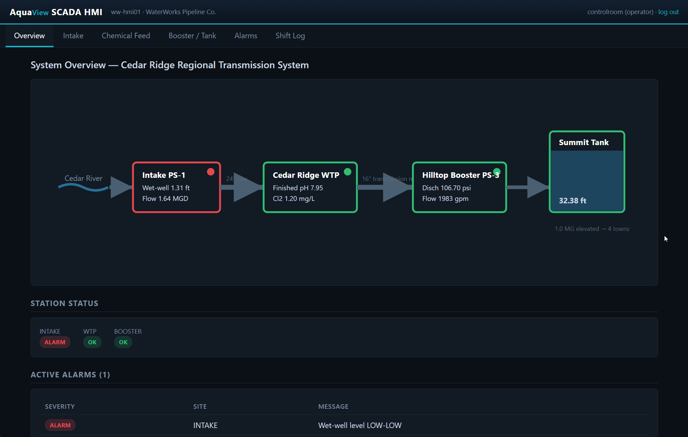

# WaterWorks Pipeline — ICS/OT Red Team Range

A self-contained [Ludus](https://ludus.cloud) range that recreates the IT and
**operational-technology (OT)** network of a fictional regional water wholesaler,
**WaterWorks Pipeline Co.**, and its *Cedar Ridge Regional Transmission System*.



Your job as a red teamer: break in from the internet, pivot across a
Purdue-segmented network, reach the industrial control systems that run the
water plant, and **prove physical impact** — overdose the chemical feed, overflow
a storage tank, rupture a transmission main — the way real attackers have against
real water utilities. Every objective is a flag you submit to the scoreboard.

> This is a **training environment**. Everything here is simulated. The attacks
> modelled are drawn from documented, real-world incidents — see
> [CASE_STUDY.md](CASE_STUDY.md) for the cited technical analysis this range is
> built on.

---

## The story

WaterWorks Pipeline Co. has delivered water to the Cedar Ridge region since 1962.
Like many small utilities, it runs a lean IT shop, a SCADA system installed and
maintained by an outside integrator (**Hydra Controls Integration LLC**), and a
board that keeps deferring the security upgrades its engineers keep asking for.

You have been engaged for a red team assessment with one goal: **determine
whether an internet-based attacker could affect the safety and availability of
the water supply.** You start outside, with nothing but the company's public
website in scope-adjacent view. Prove how far in you can get.

---

## Setup

Run the deploy script to install the ansible roles and deploy the range. Default range id is `waterworks`.
**You must have** `ludus` cli access to run this script.
```
./deploy.sh
```
After installation check logs for any failures with:

```
ludus range logs -r waterworks
```


## Network at a glance

The estate is segmented into Purdue-model zones. You (over WireGuard) can only
reach the **Internet DMZ** and the **scoreboard** directly — everything else must
be reached by pivoting.

| Zone | VLAN | Hosts | Reachable from |
|------|------|-------|----------------|
| Internet DMZ (L5) | 10 | `ww-web01` — public website & contractor portal | **You (VPN)** |
| Corporate IT (L4) | 20 | `ww-fs01` file server, `ww-it01` admin server, `ww-ws01` HR workstation (Windows) | the DMZ / internal |
| OT DMZ (L3.5) | 30 | `ww-hist01` historian, `ww-jump01` jump host | corporate IT |
| SCADA (L2/L3) | 40 | `ww-hmi01` HMI, `ww-eng01` engineering workstation | the OT DMZ |
| Field (L1) | 50 | `ww-plc01`, `ww-plc02`, `ww-rtu03` controllers | SCADA only |
| Range services | 60 | `ww-score` — **CTF scoreboard (out of scope)** | **You (VPN)** |

Addresses are `10.<your range number>.<vlan>.<host>`. The scoreboard lists the
exact IPs. Firewall rules are deliberately realistic: the segmentation is the
challenge, and the few allowed cross-zone flows model genuine utility business
needs (report sync, remote vendor support, historian polling, SCADA telemetry).

---

## The three controllers (what makes this an OT range)

These are not fake banners. Each field device runs a real process-physics model
and speaks genuine industrial protocols you can drive with standard tools
(`mbpoll`, `pymodbus`, `nmap` NSE, Metasploit Modbus modules, or the Unitronics
`PCOM` tooling you'll find on the engineering workstation):

- **`ww-plc01` — Cedar River Intake PS-1** (Modicon M340 profile): three raw-water
  pumps, a wet well, and a slide gate. Speaks **Modbus/TCP (502)** including
  Function Code 43 device identification.
- **`ww-plc02` — WTP Chemical Feed** (Unitronics Vision V570 profile): sodium
  hydroxide (pH) and chlorine dosing. Speaks **Modbus/TCP (502)** *and*
  **Unitronics PCOM/TCP (20256)** — and some memory is only reachable over PCOM.
- **`ww-rtu03` — Hilltop Booster PS-3 & Summit Tank** (SCADAPack 474 profile):
  booster pumps, a flow-control valve, a surge-anticipator valve, and an elevated
  storage tank. Speaks **Modbus/TCP (502)**.

Interfere with the process and the controllers respond like real plant equipment:
interlocks trip, pumps cavitate, pressure transients build, tanks overflow. When
you force a genuine impact condition, the controller **latches the event and
reveals the flag in its memory and on the HMI alarm screen.** After about ten
minutes the simulated plant "repairs" itself so the challenge is replayable.

---

## Objectives & scoring

There are **22 flags** (format `WTR{...}`) worth 4,200 points, grouped by category:

Recon · Initial Access · Privilege Escalation · Lateral Movement · OT DMZ ·
OT Access · OT Recon · **Impact** · Intel

- **Scoreboard:** `http://<10.x.60.10>` (also `http://scoreboard.range`). Register
  a team, read each challenge's objective, and submit flags there. The board shows
  first bloods, per-category progress, and the live rankings.
- The **Impact** flags (dry-run a pump, caustic overdose, panel defacement, tank
  overflow, main break) are the point of the range — they prove you reached Level 1
  and changed the physical process.
- The **Intel** flags are answered from [CASE_STUDY.md](CASE_STUDY.md).

The scoreboard host (`ww-score`, VLAN 60) and the range router are **out of scope**.

---

## Getting connected

1. Deploy the range (operator): see [SETUP.md](SETUP.md).
2. Get your WireGuard config from Ludus: `ludus user wireguard --range waterworks`
   (or from your Ludus admin) and bring up the tunnel.
3. Browse to the scoreboard and to `http://waterworkspipeline.com`
   (the range DNS resolves it to `ww-web01` but must be set in wg config), and begin.

Bring your own machine (Kali/your C2). No attacker VM is provisioned; `ww-web01` and `ww-ws01` are
allowed to call back out to you over the VPN for reverse shells and tunneling (default for Ludus/Proxmox is 198.51.100.X).

---

## Files in this repo

| File | Purpose |
|------|---------|
| [README.md](README.md) | This overview (player-facing, no spoilers) |
| [CASE_STUDY.md](CASE_STUDY.md) | Cited technical study of real water/OT attacks |
| [SETUP.md](SETUP.md) | Operator deployment & teardown guide |
| [WALKTHROUGH.md](WALKTHROUGH.md) | **Full solution guide (spoilers)** |
| [REDTEAM_DEBRIEF.md](REDTEAM_DEBRIEF.md) | After-action report mapping the path to ATT&CK & real incidents |
| [range.yaml](range.yaml) | Ludus range definition (VMs, flags, firewall) (**spoilers**) |
| [deploy.sh](deploy.sh) | One-command deploy (`./deploy.sh`, uses `--range waterworks`) |
| [docs/DESIGN.md](docs/DESIGN.md) | Builder's spec: every IP, credential, register & flag (**spoilers**) |
| `roles/` | Custom Ansible roles that build each host |

---

## Disclaimer

This Ludus range was created almost entirely with Claude. If you don't like that then I'm sorry.
We can and should be using AI to become better learners.

---

## Safety & ethics

The ICS behaviour here is a simulation written for this lab. The techniques are
real and are presented for **authorized training and defensive understanding**.
Attacking real water utilities endangers public health and is a serious crime.
Everything in [CASE_STUDY.md](CASE_STUDY.md) is included so defenders and
assessors understand how these systems actually fail — and how to protect them.
